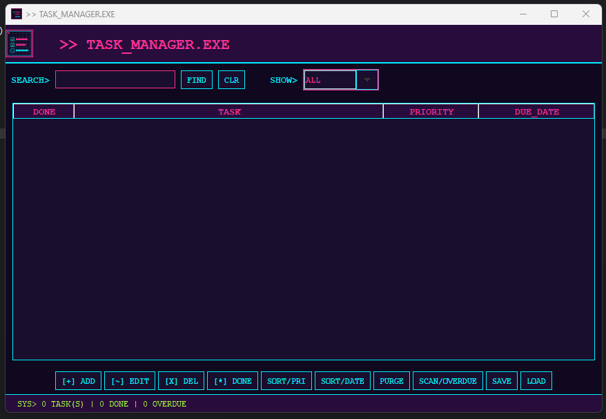
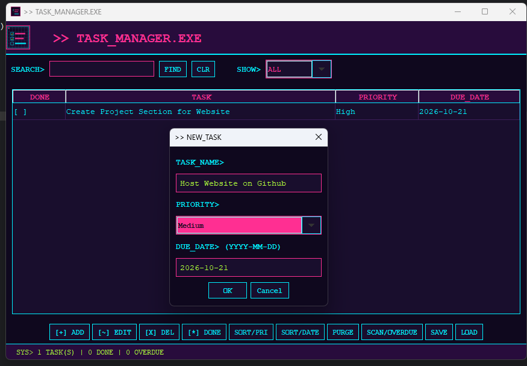

# Java Task Manager

A desktop task management application developed using Java and Swing as part of my Computer Information Systems coursework.

## Overview

This application helps users organize and manage tasks through a graphical user interface. It supports task creation, editing, deletion, priority management, due date tracking, and task completion.

## Features

- Add, edit, and delete tasks
- Assign high, medium, or low priorities
- Set due dates and identify overdue tasks
- Search and filter tasks
- Sort tasks by priority or due date
- Mark tasks as completed
- Save and load tasks using local file storage
- View tasks in a graphical interface

## Technologies Used

- Java
- Java Swing
- Eclipse IDE
- Object-Oriented Programming
- ArrayList
- File I/O

## Screenshots

### Task Creation

### Main Application

## How to Run

1. Install a Java Development Kit (JDK).
2. Download or clone this repository.
3. Open a terminal in the project directory.
4. Compile the Java files:

   `javac Task.java TaskManagerApp.java`

5. Run the application:

   `java TaskManagerApp`

## Project Purpose

This project was developed to strengthen my understanding of Java programming, object-oriented design, event-driven programming, graphical user interfaces, and data management.

## Author

Connor Bates

Computer Information Systems — Cybersecurity Emphasis
